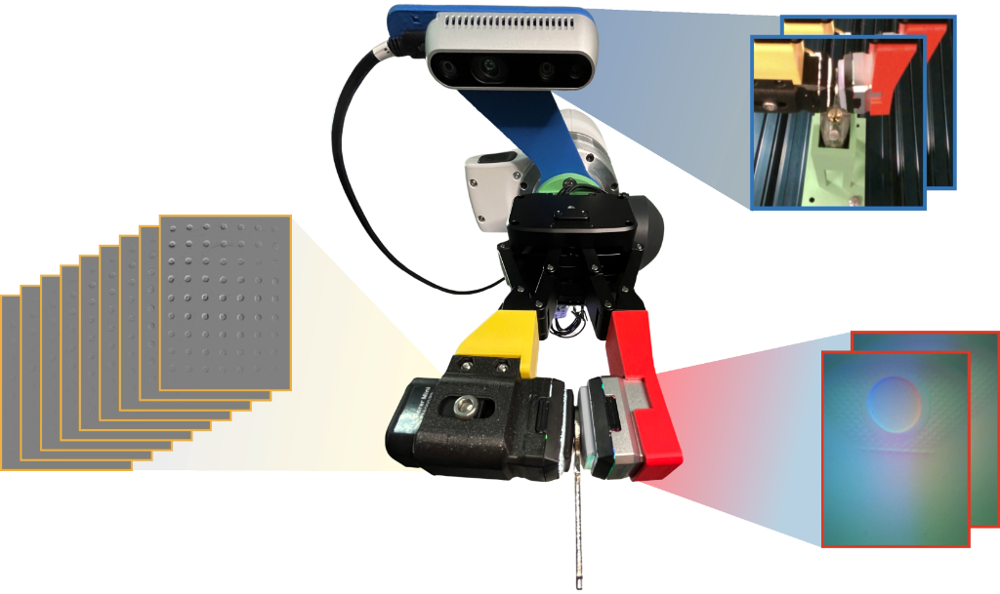

# MiTaS Sensor's



ROS 2 Humble drivers for the sensor suite used in **Multi-Resolution Tactile Imitation Learning for Contact-Rich Robotic Manipulation (MiTaS)**.

The package publishes one GelSight Mini, one Evetac event-based tactile sensor, and one Intel RealSense wrist camera. It does not include the imitation-learning code.

**Project page:** [https://mitas-touch.github.io/](https://mitas-touch.github.io/)  
**OpenReview:** [https://openreview.net/forum?id=b2gSINMX3R](https://openreview.net/forum?id=b2gSINMX3R)  
**arXiv:** [https://arxiv.org/abs/2606.06281](https://arxiv.org/abs/2606.06281)


| Sensor                   | Node                 | Topic                                |
| ------------------------ | -------------------- | ------------------------------------ |
| GelSight Mini            | `gelsight_mini_node` | `/mitas_sensors/gelsight_mini/image` |
| Evetac (DV event camera) | `evetac_node`        | `/mitas_sensors/evetac/image`        |
| RealSense wrist camera   | `realsense_node`     | `/mitas_sensors/realsense/image`     |


---


## Dependencies

Install these before building:

```bash
# ROS 2 packages
sudo apt install ros-humble-cv-bridge ros-humble-sensor-msgs

# Python packages
pip install ffmpegcv opencv-python numpy pyrealsense2

# dv-processing (iniVation SDK — follow iniVation installation docs)
# https://docs.inivation.com/software/dv-processing/installation.html
```

`pyrealsense2` also needs the [librealsense](https://github.com/IntelRealSense/librealsense) udev rules so the wrist camera is visible without root.

---


## Build

```bash
cd ~/ros2_ws/src
# copy or symlink this package here, then:
cd ~/ros2_ws
colcon build --packages-select mitas_sensors
source install/setup.bash
```

---


## Hardware setup

All sensor parameters are in [config/sensors.yaml](config/sensors.yaml). Edit that file, then relaunch. YAML keys use the `/**/node_name` form so parameters apply under the `/mitas_sensors` namespace.

**GelSight Mini.** The node opens the first V4L device whose name contains `gelsight.device_name` (default `GelSight`). List cameras with:

```bash
v4l2-ctl --list-devices
```

If the sensor is mounted upside down, set `gelsight.rotate_180: true`.

**RealSense.** Set `realsense.serial_number` to the wrist camera. The node exits if this is empty and prints the serials it can see. Color images go to `realsense/image` and `CameraInfo` (scaled to the output resolution) goes to `realsense/camera_info`. You can also list serials with:

```bash
rs-enumerate-devices
```

---


## Configuration

```
config/sensors.yaml
  gelsight_mini_node:
    ros__parameters:
      gelsight:
        capture_width / capture_height   # raw capture resolution
        output_width  / output_height    # published image resolution
        publish_rate_hz                  # Hz
        border_crop_fraction             # fraction to crop each side
        device_name                      # V4L name substring (default "GelSight")
        rotate_180                       # rotate published image 180°
        qos: reliability / history / depth

  evetac_node:
    ros__parameters:
      evetac:
        accumulation_time_ms             # event window (ms)
        decay_tau_ms                     # exponential decay time constant (ms)
        publish_rate_hz                  # Hz
        event_contribution               # accumulator sensitivity
        qos: reliability / history / depth

  realsense_node:
    ros__parameters:
      realsense:
        serial_number                    # required; see rs-enumerate-devices
        capture_width / capture_height   # raw capture resolution
        output_width  / output_height    # published image resolution
        publish_rate_hz                  # Hz
        qos: reliability / history / depth
```

---


## Launch


### All three sensors

```bash
ros2 launch mitas_sensors mitas_sensors.launch.py
```


### GelSight Mini only

```bash
ros2 launch mitas_sensors gelsight_mini.launch.py
```


### Evetac only

```bash
ros2 launch mitas_sensors evetac.launch.py
```


### RealSense only

```bash
ros2 launch mitas_sensors realsense.launch.py
```

---


## Package structure

```
mitas_sensors/
├── docs/
│   └── hero_mitas.png            # README figure
├── config/
│   └── sensors.yaml              # all sensor parameters
├── launch/
│   ├── mitas_sensors.launch.py   # GelSight, Evetac, and RealSense
│   ├── gelsight_mini.launch.py   # GelSight Mini only
│   ├── evetac.launch.py          # Evetac only
│   └── realsense.launch.py       # RealSense only
├── mitas_sensors/
│   ├── __init__.py
│   ├── gsdevice.py               # GelSight camera driver
│   ├── gelsight_mini_node.py     # GelSight Mini ROS 2 node
│   ├── evetac_node.py            # Evetac ROS 2 node
│   ├── realsense_node.py         # RealSense ROS 2 node
│   └── rs_capture.py             # RealSense capture helper
├── resource/
│   └── mitas_sensors
├── package.xml
├── setup.cfg
└── setup.py
```

---


## Citation

```bibtex
@inproceedings{
krohn2026multiresolution,
title={Multi-Resolution Tactile Imitation Learning for Contact-Rich Robotic Manipulation},
author={Rickmer Krohn and Erik Helmut and Niklas Funk and Jan Peters and Vignesh Prasad and Georgia Chalvatzaki},
booktitle={10th Annual Conference on Robot Learning},
year={2026},
url={https://openreview.net/forum?id=b2gSINMX3R}
}
```

